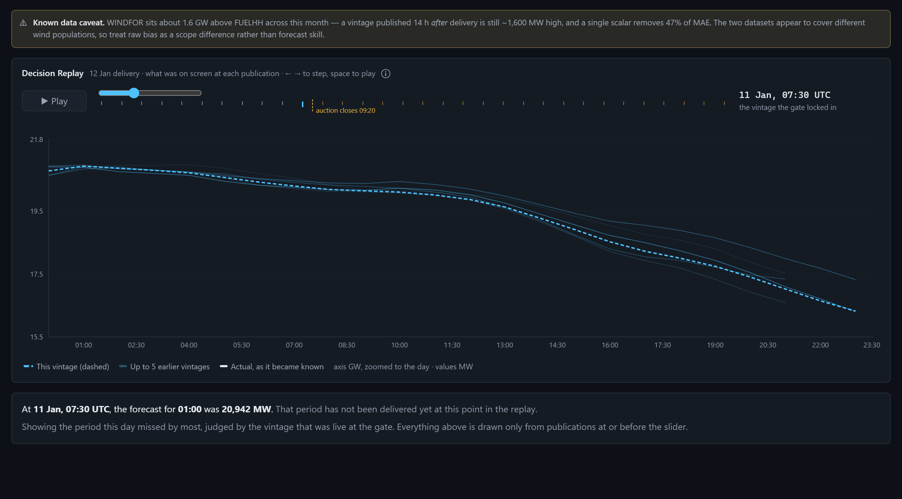
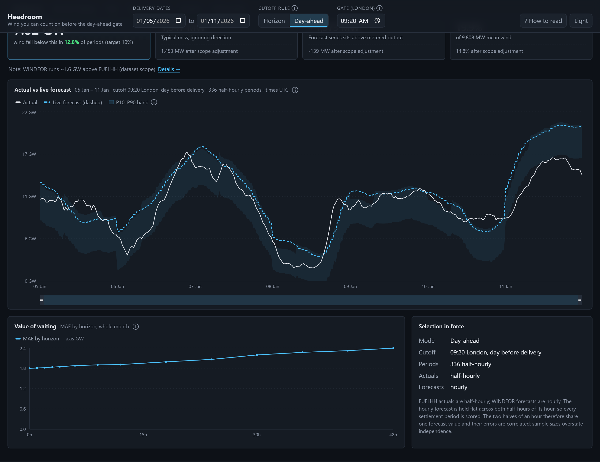
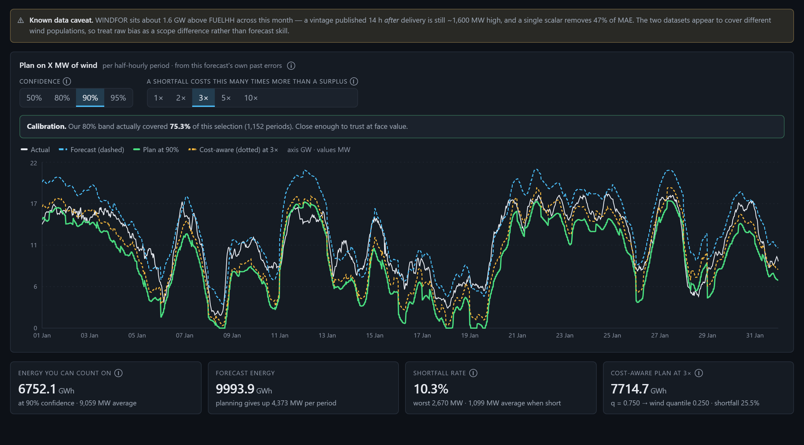

# Headroom

**Know how much wind you can count on before the day-ahead auction closes.**

A day-ahead trading desk buys power the day before delivery, and the size of that
buy depends on how much wind will show up. Headroom answers that question the way
the desk has to answer it: using only the forecast that had actually been
published when the auction gate closed, never one that appeared afterwards. It
shows the latest forecast available at decision time, quantifies how wrong those
forecasts have historically been at that notice period, and turns the error
distribution into a single number — *plan on X MW* — that you can take into the
auction. Built on Elexon BMRS national wind data for January 2026.

**Live app:** `<PASTE VERCEL URL HERE>`

---

## Decision Replay

The signature view. Pick a delivery day and drag the publish-time slider: the
chart redraws as the forecast stood at that exact moment, with older vintages
fading behind the current one. The gate marker separates what you knew from what
you did not, and the actual stays hidden until the slider passes each delivery
period — because on the day, you did not have it either.



Above: the worst miss in the month. At 07:30 on 11 January — the freshest
publication available before the 09:20 gate — the forecast for 01:00 the next day
was **20,942 MW**. The wind delivered **14,048 MW**.

| Dashboard | Plan |
|---|---|
|  |  |

**Also in this repo**

- [FINDINGS.md](FINDINGS.md) — a one-page brief for the desk, in plain English
- [DEPLOY.md](DEPLOY.md) — running it with Docker, and deploying to Vercel
- [VIDEO_SCRIPT.md](VIDEO_SCRIPT.md) — the walkthrough script

---

## Quick start

### With Docker (one command)

```bash
docker compose up --build
```

Open **http://localhost:8080**. nginx serves the frontend and proxies `/api` to
the backend, so everything is same-origin.

### Without Docker

Two terminals. Backend:

```bash
cd backend
pip install -r requirements-dev.txt
uvicorn app.main:app --reload --port 8000
```

Frontend:

```bash
cd frontend
npm install
cp .env.example .env     # VITE_API_BASE=http://localhost:8000
npm run dev
```

Open **http://localhost:5173**. Interactive API docs are at
**http://localhost:8000/api/docs**.

### Tests and linting

```bash
cd backend && pytest -q && ruff check .
cd frontend && npx eslint . && npm run build
```

### Refreshing the data snapshot

Not needed to run the app — the snapshot is committed. To refetch from Elexon:

```bash
python backend/scripts/ingest.py --force
```

---

## Folder and file guide

```
backend/
  app/
    main.py        FastAPI app: 13 GET endpoints, validation, response caching
    config.py      Constants and env overrides (gate time, grid alignment)
    data.py        Loads the committed snapshot once, cached for the process
    selection.py   THE CORE RULE: which forecast was live at a cutoff
    metrics.py     MAE, RMSE, bias, nMAE; breakdowns by horizon, hour, wind level
    bands.py       Walk-forward empirical bands, plan_on, newsvendor quantile
    analysis.py    Biggest misses, timing-vs-size decomposition, data quality
    schemas.py     Pydantic response models; MW and ISO-8601 UTC throughout
  scripts/
    ingest.py      One-off Elexon fetch -> committed CSV.gz snapshot + report
    findings.py    Runs the whole engine over the snapshot and prints findings
  data/            actuals.csv.gz, forecasts.csv.gz, ingest_report.json (~100 KB)
  tests/           95 tests, including the no-lookahead property test
  Dockerfile       python:3.12-slim, non-root, healthcheck on /api/health
frontend/
  src/
    App.jsx        Shell: top bar, tabs, routing, all state held in the URL
    api.js         Fetch layer; base URL from VITE_API_BASE
    components/    TopBar, MainChart, HorizonChart, MetricCards, SlotDrawer,
                   HowToRead, States (skeletons, empty and error states)
    pages/         Dashboard, Replay, Plan, Misses, Analysis, Quality
    lib/           useUrlState (URL as source of truth), useEndpoint, format
    styles.css     Theme tokens, layout, responsive rules
    components.css Tabs, replay controls, tables, drawer, quality panels
  nginx.conf       Static serving, /api proxy, SPA fallback for deep links
  Dockerfile       Multi-stage build, served by nginx
api/
  index.py         Vercel entrypoint; re-exports backend/app/main.py:app
vercel.json        Build, Python function, /api rewrites, SPA fallback
docker-compose.yml One-command local stack on port 8080
.github/workflows/ci.yml   ruff + pytest, eslint + build, on every push
DEPLOY.md          Docker and Vercel deployment, step by step
FINDINGS.md        One-page client brief
VIDEO_SCRIPT.md    Walkthrough script
```

---

## How it works

### The live-forecast rule

Everything rests on one definition. For a delivery period `T` and a decision
cutoff `C`, the **live forecast** is the one with the **latest `publishTime <= C`**
among all forecasts for `T`. A forecast published after `C` is never used for
`T`. Two ways to set the cutoff:

- **Horizon mode** — `C = T − H` hours, with `H` on a slider.
- **Day-ahead mode** — `C` is a clock time on the London calendar day before
  `T`'s delivery day. The default is **09:20 Europe/London**, the order-book
  closure of the EPEX SPOT GB 60-minute day-ahead auction. Nord Pool's N2EX
  hourly GB auction closes at 09:50 and the EPEX half-hourly auction at 15:30;
  both are configurable.

The rule is implemented as a vectorised `pandas.merge_asof` (backward, by target
time, exact matches allowed), which *is* the rule: take the last row at or before
the key. Periods with no eligible forecast are returned with nulls and a reason
rather than dropped, so a coverage gap shows up as a gap instead of quietly
shrinking the sample.

### The half-hour alignment choice

FUELHH actuals are half-hourly; WINDFOR forecasts are hourly. Two defensible
options, behind one config switch:

- **`hold`** (default) — the hourly forecast is held flat across both half-hours
  of its hour, so every settlement period is scored. The trading day settles
  half-hourly, so this is the grid the desk works on. The cost is that the two
  halves of an hour share one forecast value, so their errors are correlated:
  reported sample sizes overstate independence.
- **`hourly_points`** — only exact hour starts are compared. Cleaner statistics,
  at the price of discarding half the actuals.

### Walk-forward uncertainty bands

Bands come from the forecast's own track record, not from an assumed
distribution. For a target in week *k*, the error quantiles are taken from the
errors observed in **weeks strictly before *k***, within the same horizon bucket.
Since `error = forecast − actual`, the low end of the predicted actual comes from
the **high** end of the error distribution:

```
P10(actual) = forecast − Q90(error)
```

Week 0 has no earlier data, so it falls back to a pooled distribution and is
flagged `warm-up`. **That fallback does use data from its own and later weeks** —
there is no honest alternative inside a one-month snapshot — so those rows are
excluded from the calibration figures by default.

### The cost-aware buying rule

If being short is `r` times worse than being long, the newsvendor critical
fractile is `q = r / (1 + r)` of the demand you must cover. Wind is subtracted
from that demand, so the matching wind quantile is `1 − q`: the more you fear a
shortfall, the **lower** the wind figure you plan on. `r = 1` gives the median;
`r = 3` gives `q = 0.75`, so you plan on the 25th percentile of wind.

### Timing versus size

For each of the worst periods, the forecast curve is shifted by −3 to +3 hours
and each shift is scored by mean absolute error over a local window — all shifts
scored on the **same** periods, so no shift can win by averaging over a kinder
sample. Ties break toward no shift. If the best shift removes at least half the
local error, the forecast had roughly the right shape at the wrong time
(**timing**); otherwise it had the level wrong (**size**).

---

## Key findings, January 2026

All figures from the committed snapshot at the **09:20 day-ahead gate**, over all
**1,488** half-hourly delivery periods, unless stated. Reproduce with
`python backend/scripts/findings.py`.

### Read this first: the forecast series runs above the metered actuals

WINDFOR sits about **1.16×** above FUELHH — a median ratio of **1.1603** at the
24-hour horizon, which is the app's default view. Dividing the forecast by that
single scalar removes **46.5% of MAE** (2,060.6 MW falls to 1,102.0 MW) and takes
bias from **+1,848.9 MW to −6.4 MW**. The app shows that scope-adjusted figure
beside every raw one, and the same adjustment at the 09:20 day-ahead gate removes
42.2% (ratio 1.1564).

**The cause is mixed, and one month of data cannot settle it.** Binning by
forecast level, and measuring on the last vintage published *after* each delivery
period — where forecast error is largely spent and the offset is what remains —
shows two effects at once:

| Forecast level | Periods | Mean gap (F − A) | Mean ratio |
|---|---|---|---|
| 6–8 GW | 71 | +513 MW | 1.098 |
| 8–10 GW | 105 | +671 MW | 1.098 |
| 10–12 GW | 96 | +639 MW | 1.073 |
| 12–14 GW | 64 | +1,031 MW | 1.106 |
| 14–16 GW | 42 | +1,281 MW | 1.109 |
| 16–18 GW | 123 | +2,202 MW | 1.153 |
| 18–20 GW | 138 | +2,914 MW | 1.186 |
| 20–22 GW | 39 | +4,763 MW | 1.313 |

There is a **persistent 0.6–1.0 GW gap at every wind level**, which looks like the
two datasets covering different sets of wind farms. On top of that, the gap grows
sharply at high wind: **metered output saturates near 17–18 GW** (the largest
half-hour all month was 17,805 MW) while the forecast runs on to 21.2 GW. Periods
forecasting above 16 GW are 40% of the sample but contribute **72% of the total
gap** — the signature of curtailment or a metered capacity ceiling.

Both stories fit about equally well: a pure scalar (÷1.127) leaves a mean absolute
residual of **950 MW**, a pure cap (min(forecast, 15.5 GW)) leaves **976 MW**.
So this README reports the offset and does not claim a cause. Separating them
would need curtailment or capacity data, which is outside the brief's data scope.

### Accuracy at the gate

| Metric | Value |
|---|---|
| MAE | **2,145.2 MW** |
| RMSE | 2,615.8 MW |
| Bias | **+1,851.9 MW** (forecast runs high) |
| nMAE | 18.52% of mean actual |
| Median absolute error | 1,795.5 MW |
| 90th percentile absolute error | 4,274.9 MW |
| Mean actual generation | 11,580.7 MW |
| Coverage | 100% of 1,488 periods |

### Waiting helps, but less than you would think

MAE rises from **1,797.8 MW** deciding at delivery time to **2,318.6 MW**
deciding 42 hours ahead — **+29%**, about **+12.4 MW per hour of waiting**.
Coverage holds at 100% out to 42 hours and breaks to 81.2% at 48, which sets the
usable slider range.

### The gate time matters more than the forecast does

The 09:30 publication misses the 09:20 EPEX gate by **ten minutes**, so the
freshest usable vintage every day is the 07:30 one.

| Gate | MAE |
|---|---|
| EPEX 09:20 | 2,145.2 MW |
| N2EX 09:50 | 2,126.1 MW |
| EPEX half-hourly 15:30 | **1,984.5 MW** |

Moving to the 15:30 gate is worth **160 MW of MAE (7.5%)** — far more than two
hours of extra freshness at the hourly gates, which buys only 19 MW.

### The bands are honest

Walk-forward, first week excluded as warm-up, 1,152 periods:

- **P10–P90 should contain 80% — it contained 75.3%** (11.5% below, 13.3% above)
- **P25–P75 should contain 50% — it contained 49.1%**

Slightly under-covering at the wide band, near-perfect at the inner one, and
symmetric in both directions.

### What you could have counted on

| Confidence | Plan on | Below forecast by | Actually fell short |
|---|---|---|---|
| 50% | 11,773.5 MW | 1,659.2 MW | 53.4% of periods |
| 80% | 9,939.1 MW | 3,493.6 MW | 19.6% |
| **90%** | **9,059.5 MW** | 4,373.2 MW | **10.3%** |
| 95% | 8,338.3 MW | 5,094.3 MW | 6.9% |

At 90% confidence the realised shortfall rate was **10.3%** against a promised
10% — the headline result of the whole project.

### The worst day

All ten biggest misses fall on **12 January 2026**, consecutive half-hours from
00:00 to 05:30 UTC. The worst: **01:00 UTC, forecast 20,942 MW, actual 14,048 MW,
error +6,894 MW** at 17.5 hours of lead. Every one is classified **size**, not
timing — shifting the curve by up to three hours removes only 4.3–5.7% of the
local error. One bad day produces many consecutive bad half-hours, so the top-ten
list is really a list of days.

### Where the error lives

- **By hour of day:** worst at **05:00 (2,541.3 MW)**, best at **21:00
  (1,886.4 MW)** — a 35% swing, with bias following the same shape.
- **By forecast level:** absolute error grows with the forecast — **2,672.1 MW**
  above 14 GW, which is also where most of the month sits (720 of 1,488 periods).
  Relative error runs the other way: the 2–5 GW bucket is worst proportionally at
  **34.27%** of the wind involved, on 60 periods. The forecast never went below
  2 GW.

### Data quality

Spotless. **1,488 of 1,488** expected settlement periods present, zero missing
intervals, **zero duplicates** in either dataset, no zero or negative actuals
(range 1,695–17,805 MW). **264 publications**, eight per day at 02:30, 04:30,
07:30, 09:30, 11:30, 15:30, 18:30 and 22:30 UTC. One anomaly: on **15 January**
the 11:30 slot is replaced by a one-off publication at **12:25**. Lead times run
from **−25.5 to +66.5 hours** — each publication covers a fixed window from 21:00
on D−1 to 21:00 on D+2, so 3,697 rows describe periods that had already happened.

---

## Testing

**96 tests**, run with `pytest -q`. The load-bearing one is a Hypothesis
property test, `test_never_uses_future_forecasts`:

> For randomly generated forecast sets, random publication times (including ties
> and publications after delivery), and random horizons from 0 to 72 hours, the
> selected `publishTime` is always `<= cutoff`, and is always the **latest** such
> `publishTime` — checked against a brute-force reference computed independently
> of `merge_asof`.

That is the guarantee the whole product depends on: **no number anywhere in the
app was computed using a forecast that had not been published yet.** The suite
also covers exactly-at-cutoff publications, publications one second late,
horizon 0, day-ahead cutoffs across the London midnight boundary, the alignment
switch, metrics against hand-computed answers, the walk-forward discipline
(asserted on source timestamps, not just outputs), the newsvendor arithmetic,
calibration against synthetic normal errors, and every API endpoint with a known
value pinned to the committed snapshot.

---

## Limitations and next steps

**Limitations**

- **The scope offset above is unresolved.** Until it is explained, raw bias
  should be read as a dataset difference, not as forecast quality.
- **One month.** January 2026 only. Empirical bands assume the next period looks
  like a British January; they would need rebuilding for a calm summer.
- **National aggregate only.** No regional breakdown, so nothing here helps with
  constraint or locational risk.
- **No prices.** The cost-aware rule takes a *ratio* of shortfall to surplus cost
  rather than real imbalance prices, so it tells you how the plan moves, not what
  it earns.
- **The walk-forward warm-up week is not leakage-free** and is excluded from
  calibration, which costs 336 periods of sample.
- **`hold` alignment correlates adjacent half-hours**, so quoted sample sizes
  overstate independence and bands are marginally narrower than they should be.
- **Single-forecaster view.** WINDFOR is the only forecast, so there is no
  benchmark to say whether this error level is good.

**Next steps**

1. Resolve the scope offset against Elexon's dataset definitions, then offer a
   walk-forward bias correction as a toggle.
2. Extend to twelve months to get seasonal bands and a real walk-forward history.
3. Add imbalance prices and turn the ratio `r` into an expected cost in pounds.
4. Benchmark against a persistence forecast to show skill, not just error.
5. Per-period band widths by hour of day as well as horizon, given the 35% swing.

---

## AI tools used

**Claude Code was used to help build this project.** It wrote most of the code,
the tests and this documentation, working from my direction through a sequence of
phases that I defined.

I reviewed, tested and directed the work throughout: I set the scope and the
phase plan, chose the product features, reordered the work when the sequencing
was wrong, read the diffs, ran the application, and pushed back where output was
wrong or unclear. Several defects were caught and fixed this way, including a
band-quantile inversion that silently reversed the confidence slider, a Vercel
runtime pin that did not exist and would have failed deployment, and an
accessibility failure where amber text sat at 1.83:1 contrast on the light theme.
Every number in this README was pulled from the running API rather than written
from memory.

The client brief asks for this disclosure, and it would be here regardless.

---

## Data source

Elexon BMRS, via `https://data.elexon.co.uk/bmrs/api/v1/datasets/`:

- **Actuals** — `FUELHH` filtered to `fuelType=WIND`, half-hourly.
- **Forecasts** — `WINDFOR`, hourly, fetched by publication window (the only
  filter the endpoint offers) and filtered to January 2026 target times locally.

Fetched once by `backend/scripts/ingest.py` and committed as gzipped CSV. The API
reads that snapshot and never calls Elexon at request time.
